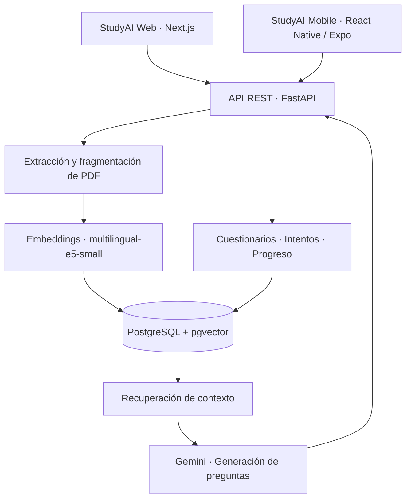

<div align="center">

# StudyAI

### Estudia con claridad.

**Asistente de estudio con inteligencia artificial, disponible en Web y Mobile.**

Convierte documentos PDF en cuestionarios personalizados mediante RAG, practica a tu ritmo y consulta tu progreso académico.

**[StudyAI Web](studyai-web/README.md)** · **[StudyAI Mobile](studyai-mobile/README.md)** · **[StudyAI API](studyai-api/README.md)**

</div>

---

## ¿Qué es StudyAI?

StudyAI es un proyecto full-stack en desarrollo que integra una aplicación web, una aplicación móvil y una API para transformar material de estudio en experiencias de práctica y evaluación.

| Web | Mobile | API |
| --- | --- | --- |
| **Next.js + React** | **React Native + Expo** | **FastAPI + PostgreSQL** |
| Dashboard, documentos, cuestionarios y estadísticas. | Documentos, cuestionarios, progreso y logros desde el teléfono. | Autenticación, procesamiento de PDF, RAG, generación con IA y persistencia. |

## Funcionalidades

- **Documentos PDF:** subir, consultar y administrar material de estudio.
- **Cuestionarios con IA:** generar preguntas basadas en documentos, con dificultad y cantidad configurables.
- **Modos Práctica y Examen:** resolver preguntas de opción múltiple y consultar los resultados.
- **Seguimiento:** revisar intentos anteriores, estadísticas, progreso y logros.
- **Rendimiento por tema (Web):** reconocer aciertos, errores y temas que conviene reforzar.
- **Web y Mobile:** dos clientes conectados a una misma API.

## Arquitectura



**RAG (Retrieval-Augmented Generation):** el backend obtiene fragmentos relevantes del documento mediante búsqueda semántica y los utiliza como contexto para generar preguntas con Gemini.

## Tecnologías

| Capa | Stack |
| --- | --- |
| **Web** | Next.js 16 · React 19 · TypeScript · Tailwind CSS 4 |
| **Mobile** | React Native · Expo · Expo Router · TypeScript |
| **Backend** | Python · FastAPI · Pydantic · API REST |
| **IA** | Google Gemini · RAG · Sentence Transformers · multilingual-e5-small |
| **Datos** | PostgreSQL · pgvector · SQL parametrizado · Alembic |
| **Herramientas** | Docker · Pytest · pnpm |

## Estructura

```text
StudyAI/
├── studyai-api/       # API, IA y persistencia
├── studyai-web/       # Cliente web
└── studyai-mobile/    # Aplicación móvil
```

## Instalación

Cada módulo tiene su propia guía:

- [Configurar la API y PostgreSQL](studyai-api/README.md)
- [Ejecutar la aplicación Web](studyai-web/README.md)
- [Ejecutar la aplicación Mobile](studyai-mobile/README.md)

## Estado del proyecto

**En desarrollo.** Las funciones principales de documentos y cuestionarios están implementadas. La generación automática de prácticas de refuerzo basadas en el rendimiento por tema y las respuestas escritas con autoevaluación forman parte del trabajo futuro.

---

<details>
<summary><strong>English overview</strong></summary>

**StudyAI** is a full-stack AI-powered learning platform built with Next.js, React Native / Expo, and FastAPI. It processes PDF study material, generates multiple-choice quizzes using retrieval-augmented generation (RAG) and Google Gemini, and helps students review their results and progress.

The platform uses PostgreSQL with pgvector, multilingual-e5-small embeddings, and a shared REST API serving its Web and Mobile clients.

StudyAI is an ongoing personal project.

</details>
